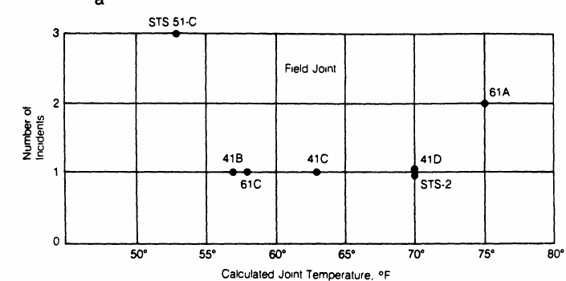

## [Homepage](../index.html)

```{r}
#| warning: false
#| echo: false
#| include: false
#| message: false
#| purl: false

knitr::purl("un_C.qmd", output = "../code/un_C.R", documentation = 0)
styler:::style_file("../code/un_C.R")

library(ggplot2)
library(ggthemes)
```

::: columns
::: {.column width="20%"}
{width="100%"}

[Original paper](https://doi.org/10.2307/2290069)
<!-- *"Pluralitas non est ponenda sine necessitate."* -->

<!-- [William of Ockham]{.grey} -->
:::

::: {.column width="80%"}

- GLMs for [binary data]{.blue} and [binomial data]{.orange} are very common, whenever the response variable is dichotomous (e.g., success/failure, yes/no, dead/alive, diseased/healthy, etc.).

- This unit will cover a few additional topics related to binary and binomial regression, including:
  - grouped vs ungrouped data;
  - the choice of the link function;
  - interpretation of responses via latent "utilities";
  - a case study: the [Challenger]{.orange} disaster.

- The most important aspects have already been covered in [Unit B](un_B.html).
:::

:::

:::callout-tip
The content of this Unit is covered in [Chapter 3]{.orange} of @Salvan2020. Alternatively, see [Chapter 5]{.blue} of @Agresti2015.
:::


## Notation and recap

- In a [binomial regression]{.blue} model, we observe $S_i$ [successes]{.blue} out of $m_i$ [trials]{.orange}
$$
S_i \overset{\text{ind}}{\sim} \text{Binomial}(m_i, \pi_i), \qquad g(\pi_i) = \eta_i = \bm{x}_i^T \beta, \qquad i=1,\dots,n.
$$
We model the proportions $Y_i = S_i / m_i$, whose mean is indeed $\pi_i$ and $Y_i \overset{\text{ind}}{\sim} \text{ED}(\mu_i, \mu_i(1-\mu_i)/m_i)$. 

- In a [binary regression]{.blue} model, we observe $Y_i \in \{0,1\}$, which is a special case of the model above with number of trials $m_i = 1$ for all $i$. Thus, we have
$$
Y_i \overset{\text{ind}}{\sim} \text{Bernoulli}(\pi_i), \qquad g(\pi_i) = \eta_i = \bm{x}_i^T \beta, \qquad i=1,\dots,n.
$$

:::callout-note
In this unit, we distinguish between [two sample size measures]{.orange}:

  - a measure $m_i$ for the number of Bernoulli trials that constitute a particular binomial observation;
  - a measure $n$ for the number of binomial observations. 
:::

## Grouped vs ungrouped data

- If $Y_{ij} \in \{0,1\}$ are independent [Bernoulli]{.blue} random variables with success probability $\pi_i$, for $j=1,\dots, m_i$ and $i=1,\dots, n$, then
$$
S_i = \sum_{j=1}^{m_i} Y_{ij} \sim \text{Binomial}(m_i, \pi_i).
$$
- Thus, any binomial regression model can be [ungrouped]{.orange} into a binary regression model with $N = \sum_{i=1}^n m_i$ observations, by replicating the covariate vector $\bm{x}_i$ $m_i$ times, with $S_i$ of the corresponding binary responses equal to $1$ and the remaining $m_i - S_i$ equal to $0$. 

- On the other hand, a binary regression model can be [grouped]{.blue} only if multiple subjects share the same values for explanatory variables, which is common if they are all categorical. 

:::callout-note
The [likelihood]{.blue} function of these two representations [coincide]{.blue} up to a proportionality constant, which means that the maximum likelihood $\hat{\beta}$ and the standard errors are identical.

However, the deviance and the residuals are different, which has implications for goodness-of-fit tests and model diagnostics. The diagnostics for binary data are typically uninformative.
:::


## Link functions I

- As discussed, the [link function]{.blue} is usually set to $g(\cdot) = F^{-1}(\cdot)$ for some [continuous cumulative distribution function]{.orange} $F(\cdot) : \mathbb{R} \to (0,1)$. In other words,
$$
g(\pi_i) = F^{-1}(\pi_i) = \bm{x}_i^T\beta,
$$
that is
$$
\mu_i = \pi_i = F(\bm{x}_i^T\beta).
$$
The function $F(\cdot)$ is strictly increasing, differentiable, and maps the real line to the unit interval.

- [Logit link]{.blue}. The canonical link is the logistic link (or logit link), that is
$$
g(\pi_i) = \log\left(\frac{\pi_i}{1-\pi_i}\right) = \bm{x}_i^T\beta, \qquad \text{ with inverse} \qquad \pi_i = \frac{\exp(\bm{x}_i^T\beta)}{1 + \exp(\bm{x}_i^T\beta)}.
$$
Indeed, the function $F(z) = \exp(z)/(1+\exp(z))$ with $z \in \mathbb{R}$ is the cdf of a [logistic distribution]{.orange} with mean $0$ and variance $\pi^2/3$.

## Link functions II

- [Probit link]{.blue}. The probit link is based on the standard normal cdf $\Phi(\cdot)$, i.e.
$$
g(\pi_i) = \Phi^{-1}(\pi_i) = \bm{x}_i^T\beta, \qquad \text{with inverse} \qquad \pi_i = \Phi(\bm{x}_i^T\beta).
$$
The function $\Phi(z)$ with $z \in \mathbb{R}$ is usually computed numerically and equals
$$
\Phi(z) = \int_{-\infty}^z \frac{1}{\sqrt{2\pi}} \exp\left(-\frac{u^2}{2}\right) du.
$$
- [Complementary log-log link]{.blue}. The complementary log-log (cloglog) link is 
$$
g(\pi_i) = \log(-\log(1-\pi_i)) = \bm{x}_i^T\beta, \qquad \text{with inverse} \qquad \pi_i = 1 - \exp(-\exp(\bm{x}_i^T\beta)).
$$
The distribution function $F(z) = 1 - \exp(-\exp(z))$ with $z \in \mathbb{R}$ is the cdf of a Gumbel distribution (for minima). This link function is [asymmetric]{.orange}.

- [Cauchy link]{.blue}. The Cauchy link is 
$$
g(\pi_i) = \tan(\pi(\pi_i - 1/2)), \qquad \text{with inverse} \qquad \pi_i = \frac{1}{2} +  \frac{\text{arctan}(\bm{x}_i^T\beta)}{\pi}.
$$
$F(z) = 1/2 + \text{arctan}(z)/\pi$ with $z \in \mathbb{R}$ is the cdf of a [standard Cauchy distribution]{.orange}.

## Link functions III

```{r}
mu <- seq(0.001, 0.999, length.out = 400)

# Compute probabilities for each link
df <- data.frame(
  mu = mu,
  logit = qlogis(mu),
  probit = qnorm(mu),
  cloglog = log(-log(1-mu)),
  cauchit = qcauchy(mu)
)

# Reshape for ggplot
df_long <- reshape2::melt(df, id.vars = "mu", 
                          variable.name = "Link", 
                          value.name = "eta")

# Plot
ggplot(df_long, aes(x = mu, y = eta, color = Link)) +
  geom_line(linewidth = 1.1) +
  theme_bw() +
  labs(
    x = expression(mu),
    y = expression(eta),
    color = "Link function"
  ) +
  scale_color_tableau(palette = "Color Blind") +
  theme(legend.position = "top" ) + ylim(c(-4, 4))
```


## Link functions IV

```{r}
eta <- seq(-4, 4, length.out = 400)

# Compute probabilities for each link
df <- data.frame(
  eta = eta,
  logit = plogis(eta),
  probit = pnorm(eta),
  cloglog = 1 - exp(-exp(eta)),
  cauchit = pcauchy(eta)
)

# Reshape for ggplot
df_long <- reshape2::melt(df, id.vars = "eta", 
                          variable.name = "Link", 
                          value.name = "Probability")

# Plot
ggplot(df_long, aes(x = eta, y = Probability, color = Link)) +
  geom_line(linewidth = 1.1) +
  theme_bw() +
  labs(
    x = expression(eta),
    y = expression(mu),
    color = "Link function"
  ) +
  scale_color_tableau(palette = "Color Blind") +
  theme(legend.position = "top" )
```


## Latent variable threshold models I

- A latent variable threshold model is a useful way to interpret binary regression models and to choose their link function $g(\cdot)$. Let  $Y_i^*$ be a [latent]{.orange} and [continuous]{.orange} random variable such that
$$
Y_i^* = \bm{x}_i^T\beta + \epsilon_i, \qquad \epsilon_i \overset{\text{iid}}{\sim} F.
$$

- A variable is called latent because we do not observe it directly. Instead, we observe only a [binary variable]{.blue} encoding whether it exceeds a certain threshold, i.e.
$$
Y_i = \mathbb{I}(Y_i^* > \tau),
$$
where $\mathbb{I}(\cdot)$ is the indicator function and $\tau$ is a threshold. 

- By construction, we have $Y_i \sim \text{Bernoulli}(\pi_i)$, with
$$
\begin{aligned}
\pi_i &= \mathbb{P}(Y_i = 1) = \mathbb{P}(Y_i^* > \tau) = \mathbb{P}(\bm{x}_i^T\beta + \epsilon_i > \tau) = 1 - \mathbb{P}(\epsilon_i \le \tau - \bm{x}_i^T\beta)= 1 - F(\tau - \bm{x}_i^T\beta).
\end{aligned}
$$

- The data contain [no information]{.orange} about $\tau$, so we can set $\tau = 0$ without loss of generality. Equivalently, the value of $\tau$ is absorbed into the intercept term. 

- Likewise, an equivalent model results if we multiply all parameters by any positive constant, so we can take $F$ to have a [standard form]{.blue} with fixed variance, such as the standard normal cdf.


## Latent variable threshold models II


- For most models $F$ corresponds to a cdf that is symmetric around 0, so $F(z) = 1 - F(-z)$. Thus, we obtain
$$
\begin{aligned}
\pi_i = 1 - F(- \bm{x}_i^T\beta) = F(\bm{x}_i^T\beta), \qquad \text{and} \qquad F^{-1}(\pi_i) = g(\pi_i) = \bm{x}_i^T\beta.
\end{aligned}
$$
That is, models for binary data naturally take the [link function]{.blue} to be the [inverse of the standard cdf]{.orange} for a family of continuous distributions for a latent variable.

:::callout-note
This dichotomization often corresponds to a real process — for instance, in medical diagnosis, preterm birth can be seen as a dichotomization of gestational age at delivery.

However, there are cases where the existence of a latent quantity is more questionable, such as $Y_i^*$ corresponding to a notion of "ability" and $Y_i$ to "passing an exam".
:::

## Logistic regression

- The [likelihood equations]{.blue} of a binomial regression model are fairly simple:
$$
\sum_{i=1}^n \frac{m_i (y_i - \pi_i)}{\pi_i(1 - \pi_i)} x_{ir} f(\eta_i) = 0, \qquad r=1,\dots, p,
$$
where $f(z)$ is the density associated with $F(z)$, i.e. its derivative, and the [link]{.orange} is $g(\cdot) = F^{-1}(\cdot)$. 

- In logistic regression $f(\eta_i) = F(\eta_i)(1 - F(\eta_i)) = \pi_i(1 - \pi_i)$, therefore
$$
\sum_{i=1}^n m_i (y_i - \pi_i) x_{ir} = 0, \qquad r=1,\dots, p.
$$
The solution has a nice interpretation as a [method of moments]{.blue} estimator, in that
$$
\sum_{i=1}^n s_i x_{ir} = \sum_{i=1}^n \mathbb{E}(S_i) x_{ir}, \qquad r=1,\dots, p.
$$
Moreover, the estimated covariance matrix of $\hat{\beta}$ has a simple form:
$$
\widehat{\text{var}}(\hat{\beta}) = (\bm{X}^T \hat{\bm{W}} \bm{X})^{-1} = (\bm{X}^T \text{diag}[m_1 \hat{\pi}_1 (1-\hat{\pi}_1),\dots,m_n \hat{\pi}_n (1-\hat{\pi}_n)] \bm{X})^{-1}.
$$

## Parameter interpretation

- We wish to [compare two estimated probabilities]{.blue}, corresponding to two different covariate vectors $\bm{x} = (x_1,\dots,x_p)$ and $\bm{x}' = (x_1',\dots,x_p')$, namely
$$
\pi(\bm{x}) = F(\bm{x}^T\beta)\qquad \text{and} \qquad \pi(\bm{x}') = F((\bm{x}')^T\beta).
$$
This is useful to understand the effect of changing covariates on the response probability.

- There are several ways to compare them, listed below, each with its advantages and disadvantages:

  - The [risk difference]{.blue}, namely the difference 
    $$
    (\text{risk difference}) = \pi(\bm{x}') - \pi(\bm{x}).
    $$

  - The [relative risk]{.orange} is the fraction
    $$
    (\text{relative risk}) = \frac{\pi(\bm{x}')}{\pi(\bm{x})}.
    $$
- Both these indicators are quite interpretable but depend on the specific values of $\bm{x}$ and $\bm{x}'$, which makes it difficult to summarize the effect of a given covariate in a single number.

## Odds ratio

- The [odds]{.blue} is another way of summarizing probabilities, familiar to those who gamble:
$$
\text{odds}(\bm{x}) = \frac{\pi(\bm{x})}{1-\pi(\bm{x})}.
$$
The odds are non-negative, with $\text{odds}(\bm{x}) > 1$ when a [success is more likely than a failure]{.blue}. 

- When $\pi(\bm{x}) = 0.75$ then $\text{odds}(\bm{x}) = 0.75/0.25 = 3$; a success is three times as likely as a failure. That is, we bet 3 to get 1 if we win. If instead $\text{odds}(\bm{x}) = 1 / 3$, we bet 1 to get 3 if we win. 

- The [odds ratio]{.orange} is another popular risk measure for comparing the two probabilities:
$$
(\text{odds ratio})  = \frac{\text{odds}(\bm{x}') }{\text{odds}(\bm{x}) }= \frac{\pi(\bm{x}')}{\pi(\bm{x})} \cdot \frac{1-\pi(\bm{x})}{1-\pi(\bm{x}')}.
$$

- Let $\bm{x} = (x_1,\dots, x_j, \dots, x_p)$ and $\bm{x}' = (x_1, \dots, x_j + c, \dots, x_p)$, i.e. we compare two situations in which the $j$th covariate is increased by a fixed amount $c$, then in [logistic regression]{.blue}:
$$
(\text{odds ratio}) = \exp(c \beta_j),
$$
which is a [constant number]{.orange} that does not depend on $\bm{x}$. This is not true e.g. in probit.

## Odds ratio and logistic regression

- Let $\bm{x}$ be a generic covariate vector and consider its odds under a [logistic regression]{.blue} model:
$$
\text{odds}(\bm{x}) = \frac{\pi(\bm{x})}{1-\pi(\bm{x})} = \frac{\exp(\bm{x}^T\beta)}{1 + \exp(\bm{x}^T\beta)} \cdot \left(\frac{1}{1 + \exp(\bm{x}^T\beta)}\right)^{-1} = \exp(\bm{x}^T\beta).
$$
Thus, the odds at any covariate value are simply the exponential of the linear predictor $\bm{x}^T\beta$. 

- Consequently, in general the [odds ratio]{.blue} is
$$
(\text{odds ratio}) = \frac{\text{odds}(\bm{x}') }{\text{odds}(\bm{x}) } = \exp\{(\bm{x}'- \bm{x})^T\beta \}.
$$

- If the only change is in the $j$th covariate, from $x_j$ to $x_j + c$, then the odds ratio becomes
$$
(\text{odds ratio}) = \exp\{(\bm{x}'- \bm{x})^T\beta \} = \exp(c \beta_j).
$$
In particular, $\exp(\beta_j)$ represents the odds ratio after a [unit increase]{.orange} of the $j$th covariate. 


## Residuals and diagnostics for binary data

- In presence of [binary data]{.orange}, namely when $m_i = 1$ and $Y_i \sim \text{Bernoulli}(\pi_i)$, many of the diagnostic tools are [degenerate]{.orange} and uninformative.

- For example, the `fitted` vs `residuals` plot, namely the scatter plot of the points $(\hat{\pi}_i, y_i - \hat{\pi}_i)$, simply shows two parallel lines with slope $-1$, which is uninformative. 


- As an extreme case, consider the [null model]{.blue} in which $\pi_1 = \dots = \pi_n$, then the $X^2$ statistic is
$$
X^2 = \sum_{i=1}^n \frac{(y_i - \hat{\pi})^2}{\hat{\pi}(1 - \hat{\pi})} = n,
$$
whatever the observed data, since $\hat{\pi} = \bar{y}$ and therefore $\sum_{i=1}^n(y_i - \bar{y})^2 = n\bar{y}(1-\bar{y})$.

- A common solution is to [group the data]{.blue} according to some criterion, although this introduces approximations and some arbitrariness (e.g. the Hosmer–Lemeshow test). 

- In terms of prediction, there exist various indices and techniques that you will cover in Data Mining. The simplest index is the [accuracy]{.orange}, i.e. the fraction of correct predictions.

<!-- ## Goodness-of-fit test -->

## Overdispersion

- In binomial regression the main [assumption]{.blue} is that $S_i \sim \text{Binomial}(m_i, \pi_i)$, implying that
$$
\text{var}(Y_i) = \frac{\pi_i(1-\pi_i)}{m_i},
$$
where implicitly we have set $\phi = 1$. 

- However, from the analysis of the residuals or by computing the $X^2$ statistic we may realize that the data present [overdispersion]{.orange}, namely a [more appropriate model]{.blue} is such that
$$
\text{var}(Y_i) = \textcolor{red}{\phi} \frac{\pi_i(1-\pi_i)}{m_i},
$$
with $\phi > 1$. This implies that the binomial regression model is [misspecified]{.orange}. 

- Overdispersion can only occur with [grouped data]{.blue}: when $m_i = 1$, any distribution on $\{0, 1\}$ has variance $\pi_i(1-\pi_i)$, so necessarily $\phi = 1$.

<!-- - The two most common solutions to overdispersion are the following:  -->
<!--   (i) the use of [quasi-likelihoods]{.blue}, see [Unit E](un_E.html); -->
<!--   (ii) using another parametric distribution, beyond the class of exponential dispersion families; a typical choice is the [beta-binomial]{.orange}. -->

# Case study: the `shuttle` data

## The Challenger disaster

::: columns
::: {.column width="40%"}
{width="100%"}
:::

::: {.column width="60%"}
- The space shuttle [Challenger]{.orange} broke apart 73 seconds after its launch on [28 January 1986]{.blue}. All seven crew members died.

- The [Presidential Commission](https://www.nasa.gov/history/rogers-commission-report) found that the cause was a [gas leak]{.orange} through a joint of the right solid rocket motor.

- The joint was sealed by rubber [O-rings]{.blue}, which do not seal properly at low temperatures. 

- The forecast for the launch was [31°F]{.orange} (about $-0.5$°C).


:::
:::

:::callout-tip
- Netflix docuseries: [*Challenger: The Final Flight* (2020)](https://www.netflix.com/title/81012137) 

- @Dalal1989, *Risk analysis of the space shuttle: pre-Challenger prediction of failure*, JASA.
:::

## O-rings and thermal distress

::: columns
::: {.column width="35%"}
{width="90%"}
:::

::: {.column width="65%"}
- The two solid rocket motors have [six field joints]{.blue} in total. Each joint is sealed by a [primary]{.orange} and a secondary O-ring.

- A primary O-ring experiences [thermal distress]{.orange} if:
  - hot gas burns part of the ring ([erosion]{.blue});
  - hot gas leaks past the ring before it seals ([blowby]{.blue}).

- Bench tests had shown that O-rings [lose their resilience]{.blue} at [low temperatures]{.orange}.

- During a public hearing, [Richard Feynman](https://en.wikipedia.org/wiki/Richard_Feynman) showed this by dipping a piece of O-ring in a glass of ice water.
:::
:::

## The night before the launch

::: columns
::: {.column width="45%"}
{width="100%"}
:::

::: {.column width="55%"}
- On 27 January 1986, engineers of [Morton Thiokol]{.blue}, the manufacturer of the motors, and NASA discussed the launch in a teleconference.

- The discussion focused on the plot on the left:
  - it displays the [7 flights]{.blue} with at least one O-ring incident;
  - the [16 flights]{.orange} with no incidents were left out.

- Some engineers asked to postpone the launch, but Thiokol concluded that "*temperature data [are] not conclusive*". 

- The launch was approved.
:::
:::

## The `shuttle` dataset

- The `shuttle` dataset of the `SMPracticals` library contains the data of the [23 flights]{.blue} before the accident.

  - `r`: number of primary field-joint O-rings with thermal distress, out of `m` $= 6$;
  - `temperature`: calculated joint temperature at launch (°F);
  - `pressure`: pressure of the leak-check test performed before each launch (psi).

```{r}
#| classes: styled-output
data("shuttle", package = "SMPracticals")
rownames(shuttle) <- NULL # Old-style row names, otherwise glm returns an error
head(shuttle)
```

- There were 24 launches before the accident, but the motors of one flight were lost at sea.

- The leak-check pressure was [increased]{.orange} over time: 50 psi in the first six flights, 100 psi in the next two, then 200 psi.

## Exploratory analysis

```{r}
#| fig-width: 9
#| fig-height: 3.6
#| fig-align: center
set.seed(123) # The x-values are jittered to avoid overplotting
shuttle_long <- rbind(
  data.frame(x = jitter(shuttle$temperature, amount = 0.5), y = shuttle$r / shuttle$m, variable = "Temperature (°F)"),
  data.frame(x = jitter(shuttle$pressure, amount = 5), y = shuttle$r / shuttle$m, variable = "Pressure (psi)")
)
shuttle_long$variable <- factor(shuttle_long$variable, levels = c("Temperature (°F)", "Pressure (psi)"))
shuttle_long$plotted <- factor(ifelse(shuttle_long$y > 0, "Plotted the night before", "Left out"),
  levels = c("Plotted the night before", "Left out")
)

ggplot(shuttle_long, aes(x = x, y = y, color = plotted)) +
  geom_point() +
  geom_vline(data = data.frame(variable = factor("Temperature (°F)", levels = levels(shuttle_long$variable)), x = 31), aes(xintercept = x), linetype = "dotted", inherit.aes = FALSE) +
  geom_blank(data = data.frame(variable = factor("Temperature (°F)", levels = levels(shuttle_long$variable)), x = 30, y = 0), inherit.aes = FALSE, aes(x = x, y = y)) +
  facet_wrap(~variable, scales = "free_x", strip.position = "bottom") +
  ylim(c(0, 1)) +
  scale_color_manual(values = c("#FF8C00", "#3232AA")) +
  theme_light() +
  theme(
    strip.placement = "outside", strip.background = element_blank(), strip.text = element_text(color = "black", size = 11),
    legend.position = "top", legend.title = element_blank()
  ) +
  xlab(NULL) +
  ylab("Proportion of distressed O-rings")
```

- As [temperature]{.blue} decreases, the proportion of distressed O-rings [increases]{.orange}. There is less pattern for [pressure]{.blue}.

- All the [16 flights left out]{.blue} the night before were launched at 66°F or above.

- The dotted line is the 31°F forecast, 22°F below the coldest previous launch (53°F).

## Modelling the `shuttle` data

- Let $S_i$ be the number of distressed O-rings in the $i$th flight. If, within each flight, the six O-rings fail [independently]{.orange} and with the [same probability]{.orange} $\pi_i$, then
$$
S_i \overset{\text{ind}}{\sim} \text{Binomial}(6, \pi_i), \qquad i = 1,\dots,23.
$$

- We consider a [logistic regression]{.blue} model, with $x_{i1}$ the temperature and $x_{i2}$ the pressure:
$$
\text{logit}(\pi_i) = \log\left(\frac{\pi_i}{1 - \pi_i}\right) = \beta_1 + \beta_2 x_{i1} + \beta_3 x_{i2}.
$$

- Our main goal is the [probability of thermal distress at 31°F]{.orange} which, if pressure has no effect ($\beta_3 = 0$), is
$$
\psi = \frac{\exp(\beta_1 + 31 \beta_2)}{1 + \exp(\beta_1 + 31 \beta_2)}.
$$

## The full model

```{r}
#| classes: styled-output
fit_full <- glm(cbind(r, m - r) ~ temperature + pressure,
  family = binomial, data = shuttle
)
summary(fit_full)
```

- Given temperature, the Wald test for $H_0: \beta_3 = 0$ gives $W_e = 1.105^2$ (p-value $0.269$). Any [pressure]{.blue} effect is [slight]{.orange} or absent.


## The temperature model

```{r}
#| classes: styled-output
fit_temp <- update(fit_full, . ~ . - pressure)
fit_null <- update(fit_full, . ~ 1)

summary(fit_temp)
```

- Without pressure, the Wald test for $H_0: \beta_2 = 0$ gives $W_e = 2.458^2$ (p-value $0.014$). There is evidence of a [temperature]{.blue} effect.

## Interpretation of the coefficients

- The [estimated probability]{.blue} that an O-ring experiences thermal distress at temperature $x$ is
$$
\hat{\pi}(x) = \frac{\exp(`r round(coef(fit_temp)[1], 3)` `r round(coef(fit_temp)[2], 3)` \, x)}{1 + \exp(`r round(coef(fit_temp)[1], 3)` `r round(coef(fit_temp)[2], 3)` \, x)}.
$$

```{r}
OR_1 <- exp(coef(fit_temp)[2])
OR_10 <- exp(-10 * coef(fit_temp)[2])
OR_10_CI <- exp(-10 * confint.default(fit_temp)[2, ])
```

- The intercept $\hat{\beta}_1$ is [not of interest]{.orange}:
  - it is the logit of the probability of distress at 0°F, i.e. $\hat{\pi}(0) =$ `r round(plogis(coef(fit_temp)[1]), 3)`;
  - 0°F is far outside the range of the data.

- An [increase]{.blue} of 1°F multiplies the [odds]{.orange} of distress by $\exp(\hat{\beta}_2) =$ `r round(OR_1, 3)`, i.e. the odds decrease by `r round(100 * (1 - OR_1), 1)`%, whatever the starting temperature.

- A [decrease]{.blue} of 10°F, from $x$ to $x - 10$, gives the [odds ratio]{.orange}
$$
\frac{\widehat{\text{odds}}(x - 10)}{\widehat{\text{odds}}(x)} = \frac{\exp\{\hat{\beta}_1 + \hat{\beta}_2 (x - 10)\}}{\exp(\hat{\beta}_1 + \hat{\beta}_2 x)} = \exp(-10 \hat{\beta}_2) = `r round(OR_10, 3)`,
$$
that is, the odds increase by $100 \times (`r round(OR_10, 3)` - 1) =$ `r round(100 * (OR_10 - 1), 1)`%, whatever the starting temperature.


## Probabilities, odds and risks

- Estimated probabilities $\hat{\pi}(x)$ and odds $\widehat{\text{odds}}(x) = \hat{\pi}(x) / \{1 - \hat{\pi}(x)\}$ of thermal distress:

```{r}
temp_grid <- c(70, 60, 50, 31)
pi_hat <- predict(fit_temp, newdata = data.frame(temperature = temp_grid), type = "response")
odds_hat <- pi_hat / (1 - pi_hat)
tab_prob <- rbind(pi_hat, odds_hat)
rownames(tab_prob) <- c("Probability $\\hat{\\pi}(x)$", "Odds $\\widehat{\\text{odds}}(x)$")
colnames(tab_prob) <- paste0("$x = ", temp_grid, "$°F")
knitr::kable(tab_prob, digits = 3)
```

- For a [decrease of 10°F]{.blue}, from $x$ to $x - 10$, we compare $\hat{\pi}(x - 10)$ with $\hat{\pi}(x)$:

```{r}
tab_risk <- data.frame(
  `Temperature (°F)` = paste0(temp_grid[1:2], " → ", temp_grid[2:3]),
  `Risk difference` = pi_hat[2:3] - pi_hat[1:2],
  `Relative risk` = pi_hat[2:3] / pi_hat[1:2],
  `Odds ratio` = odds_hat[2:3] / odds_hat[1:2],
  check.names = FALSE
)
knitr::kable(tab_risk, digits = 3, row.names = FALSE)
```

- The [risk difference]{.blue} and the [relative risk]{.blue} depend on the starting temperature $x$, whereas the [odds ratio]{.orange} is always $\exp(-10\hat{\beta}_2) =$ `r round(OR_10, 3)`.

:::callout-warning
The odds ratio is a variation of the [odds]{.orange}, [not]{.orange} of the [probabilities]{.blue}. For instance, from 60°F to 50°F the probability of distress is multiplied by `r round(pi_hat[3] / pi_hat[2], 3)`, not by `r round(OR_10, 3)`.
:::

## Probability of distress at 31°F

```{r}
pred <- predict(fit_temp, newdata = data.frame(temperature = 31), se.fit = TRUE)
psi_hat <- plogis(pred$fit)
se_psi <- psi_hat * (1 - psi_hat) * pred$se.fit # Delta method

CIs <- rbind(
  psi_hat + c(-1, 1) * qnorm(0.975) * se_psi,
  plogis(pred$fit + c(-1, 1) * qnorm(0.975) * pred$se.fit)
)
colnames(CIs) <- c("Lower", "Upper")
rownames(CIs) <- c("Wald, delta method", "Wald, logit scale")
```

- The estimated probability of distress at 31°F is $\hat{\psi} =$ `r round(psi_hat, 3)`. We expect $6 \hat{\psi} =$ `r round(6 * psi_hat, 1)`, i.e. [four to five]{.orange}, distressed O-rings out of six.

```{r}
knitr::kable(CIs, digits = 3)
```

- The Wald interval for $\psi$ based on the [delta method]{.blue} contains values [greater than one]{.orange}, so it is inappropriate.

- The Wald interval computed on the [logit scale]{.blue} and then transformed, as in [Unit B](un_B.html), always lies in $(0, 1)$.

## Estimated probability of distress

```{r}
#| fig-width: 7
#| fig-height: 3.6
#| fig-align: center
new_temp <- data.frame(temperature = seq(30, 85, length.out = 200))
pred_temp <- predict(fit_temp, newdata = new_temp, se.fit = TRUE)
new_temp$fit <- plogis(pred_temp$fit)
new_temp$lower <- plogis(pred_temp$fit - qnorm(0.975) * pred_temp$se.fit)
new_temp$upper <- plogis(pred_temp$fit + qnorm(0.975) * pred_temp$se.fit)

ggplot(new_temp, aes(x = temperature, y = fit)) +
  geom_ribbon(aes(ymin = lower, ymax = upper), alpha = 0.2) +
  geom_line() +
  geom_point(data = shuttle, aes(x = temperature, y = r / m)) +
  geom_vline(xintercept = 31, linetype = "dotted") +
  theme_bw() +
  xlab("Temperature (°F)") +
  ylab("Proportion of distressed O-rings")
```

- Estimated probability of distress, with pointwise 95% confidence intervals computed on the logit scale.

- The prediction at 31°F is an [extrapolation]{.orange} far outside the data, but there would have been little alternative.

## Choice of the link function

```{r}
#| fig-width: 7
#| fig-height: 3.6
#| fig-align: center
fit_probit <- update(fit_temp, family = binomial(link = "probit"))
fit_cloglog <- update(fit_temp, family = binomial(link = "cloglog"))

df_links <- data.frame(
  temperature = new_temp$temperature,
  logit = predict(fit_temp, newdata = new_temp, type = "response"),
  probit = predict(fit_probit, newdata = new_temp, type = "response"),
  cloglog = predict(fit_cloglog, newdata = new_temp, type = "response")
)
df_links <- reshape2::melt(df_links,
  id.vars = "temperature",
  variable.name = "Link", value.name = "Probability"
)

ggplot(df_links, aes(x = temperature, y = Probability, color = Link)) +
  geom_line(linewidth = 1.1) +
  geom_point(data = shuttle, aes(x = temperature, y = r / m), inherit.aes = FALSE) +
  geom_vline(xintercept = 31, linetype = "dotted") +
  scale_color_tableau(palette = "Color Blind") +
  theme_bw() +
  labs(color = "Link function") +
  theme(legend.position = "top") +
  xlab("Temperature (°F)") +
  ylab("Proportion of distressed O-rings")
```

- The deviances are `r round(deviance(fit_temp), 2)` (logit), `r round(deviance(fit_probit), 2)` (probit) and `r round(deviance(fit_cloglog), 2)` (cloglog): the three fits are almost identical in the range of the data.

- However, the estimated probabilities at 31°F are [different]{.orange}: `r sprintf("%.2f", predict(fit_temp, data.frame(temperature = 31), type = "response"))`, `r sprintf("%.2f", predict(fit_probit, data.frame(temperature = 31), type = "response"))` and `r sprintf("%.2f", predict(fit_cloglog, data.frame(temperature = 31), type = "response"))`, respectively.

<!-- ## Residuals -->

<!-- ```{r} -->
<!-- #| fig-width: 9 -->
<!-- #| fig-height: 3.6 -->
<!-- #| fig-align: center -->
<!-- par(mfrow = c(1, 2)) -->
<!-- plot(shuttle$temperature, rstandard(fit_temp, type = "deviance"), -->
<!--   pch = 16, xlab = "Temperature (°F)", ylab = "Standardized deviance residuals" -->
<!-- ) -->
<!-- abline(h = 0, lty = "dotted") -->
<!-- plot(fit_temp, 4) -->
<!-- par(mfrow = c(1, 1)) -->
<!-- ``` -->

<!-- - The deviance is `round(deviance(fit_temp), 2)` on $21$ degrees of freedom, whereas $X^2 =$ `round(sum(residuals(fit_temp, type = "pearson")^2), 2)`. With such small counts, the $\chi^2$ approximation is questionable. -->

<!-- - Flight 61-A (observation $21$), launched at 75°F with two distressed O-rings, has the largest residual and the largest [Cook's distance]{.orange}. -->

<!-- ## Further checks -->

<!-- ```{r} -->
<!-- fit_no61A <- update(fit_temp, subset = -21) # Without flight 61-A -->
<!-- fit_quad <- update(fit_temp, . ~ . + I(temperature^2)) -->
<!-- ``` -->

<!-- - Removing flight 61-A, the temperature effect becomes [stronger]{.orange}: $\hat{\beta}_2$ changes from `round(coef(fit_temp)[2], 3)` to `round(coef(fit_no61A)[2], 3)`. -->

<!-- - A [quadratic term]{.blue} in temperature is not needed: -->

<!-- ```{r} -->
<!-- #| classes: styled-output -->
<!-- anova(fit_temp, fit_quad, test = "Chisq") -->
<!-- ``` -->

## Conclusions

- [Goodness of fit]{.blue}: the deviance is `r round(deviance(fit_temp), 2)` on $21$ degrees of freedom and $X^2 =$ `r round(sum(residuals(fit_temp, type = "pearson")^2), 2)`.
  - The counts are small and the $\chi^2$ approximation is rough, but there is no clear evidence of lack of fit.

- The [temperature effect]{.blue} is robust: logit, probit and cloglog links fit the data equally well and agree on its sign.

- At 31°F we are [extrapolating]{.orange}, 22°F below any previous launch: the 95% confidence interval for $\psi$ is (`r sprintf("%.2f", CIs[2, 1])`, `r sprintf("%.2f", CIs[2, 2])`).

- Yet all models point to a [high probability]{.orange} of distress at 31°F, and no data supported the safety of such a launch.

:::callout-warning
The prediction is uncertain, but given the [catastrophic consequences]{.orange} of a failure, caution would have required to [postpone the launch]{.blue}.
:::

## Epilogue

::: columns
::: {.column width="45%"}
{width="100%"}

The crew of the Challenger. Source: NASA.
:::

::: {.column width="55%"}
- The Rogers Commission: "*a careful analysis of the flight history of O-ring performance would have revealed the correlation of O-ring damage in low temperature*".

- Building on this model, @Dalal1989 estimated a probability of [catastrophic failure]{.orange} of at least $0.13$ at 31°F, against $0.02$ at 60°F.

- After the accident, NASA started to perform probabilistic risk assessments. Crewed flights resumed only in September 1988.

:::callout-warning
The lesson: [never discard the zeros]{.orange}. The flights with no incidents are the ones showing that warm launches were safe.
:::
:::
:::

## References